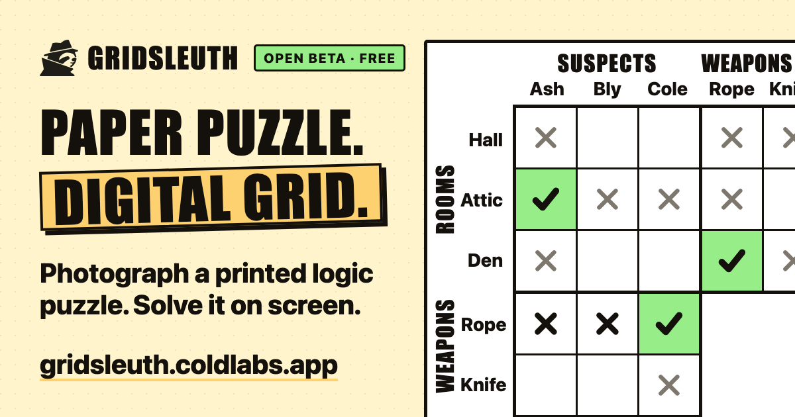

Small games and tools, made with care. Each one does a single thing well and leaves the thinking to you.

## GridSleuth

Photograph a printed logic-grid puzzle and solve it on screen. The deducing stays yours.

GridSleuth is in open beta and free.

**[Play it](https://gridsleuth.coldlabs.app/play/)** · [Join the founding beta](https://gridsleuth.coldlabs.app/#beta)

 

## QGIS plugins

Free open data, straight into QGIS. Download for the map view or for the polygons of a layer. Install them from QGIS with *Plugins › Manage and Install Plugins*.

| Plugin | What you get | Get it |
| --- | --- | --- |
| **Open Buildings Downloader** | Google Open Buildings v3 footprints, as polygons, centroid points or both, with confidence, area and Plus Code | [QGIS plugins](https://plugins.qgis.org/plugins/open_buildings_downloader/) · [source](https://github.com/ColdLabs/qgis-open-buildings) |
| **GlobalML Buildings Downloader** | Microsoft Global ML Building Footprints, with height, confidence and area, coloured by height | [QGIS plugins](https://plugins.qgis.org/plugins/globalml_buildings_downloader/) · [source](https://github.com/ColdLabs/qgis-globalml-buildings) |
| **OpenAddresses Downloader** | OpenAddresses address points (number, street, unit, city, postcode), with the licences of the sources that cover your area | [QGIS plugins](https://plugins.qgis.org/plugins/openaddresses_downloader/) · [source](https://github.com/ColdLabs/qgis-openaddresses) |
| **GEM-15 Elevation Downloader** | Google GEM-15 elevation at 15 m: bare-earth DTM, surface DSM and height above ground (nDSM), as GeoTIFFs | [zip](https://github.com/ColdLabs/qgis-gem15-elevation/releases/latest) · [source](https://github.com/ColdLabs/qgis-gem15-elevation) |

These plugins are unofficial. The data belongs to its publishers, under their licences.

## Agent tools

**[codex-imagegen](https://github.com/ColdLabs/codex-imagegen)** is an agent skill that generates and edits images with your own ChatGPT or Codex login. It needs no API key.

---

[coldlabs.app](https://coldlabs.app) · [support@coldlabs.app](mailto:support@coldlabs.app)
